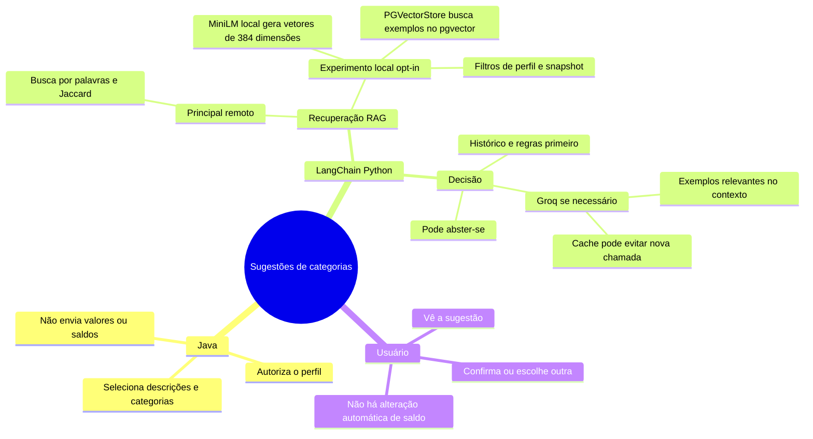

# Como LangChain e RAG funcionam hoje

**Evolução local em17/11, ainda não publicada:**
[salário e módulos integrados](salario-modulos-integrados-local.md). A regra
opcional de salário é instrução exata no Java, sem RAG/LLM. Salário previsto
é manual; gastos/metas são calculados com decimais no Java. Detalhes de cartão
agora podem reutilizar a fila/classificador existente: correções e histórico
privado primeiro, RAG e até uma chamada LLM quando necessário, respeitando opt-out.
Python/modelos/embeddings não mudaram nesta entrega. Não há envio de posições,
saldos, faturas completas ou salário previsto ao modelo. Testes de tela usam
provedores fictícios e Python local com modelo desligado. Produção continua V16.

**Produção em17/11, V16:** [planejador com salário/gastos](metas-renda-mensal-local.md), [publicação e rollback](publicacao-metas-renda-2026-11-17.md). LangChain interpreta objetivo e perguntas de resumo com RunnableLambda, sem chamar o LLM; Java obtém o contexto owner-scoped, separa salário de outras entradas, calcula gastos mensais e capacidade após compromissos/metas e mostra aporte/diferença/prazo. Valores dos relatórios não vão à Groq nem ao banco vetorial. O RAG de categorias continua separado, com prioridade humana e até uma chamada LLM quando necessária. As entradas abaixo sobre evolução somente local e V15 são históricas.

**Produção mais recente, 16/11:** [organização publicada](publicacao-organizacao-2026-11-16.md), V15, Java/Python novos e verificados. IA default-on em novos cadastros/primeiro vínculo sem preferência anterior; opt-out e correções preservados. Regra PIX, histórico, RAG com dois exemplos fortes e até uma chamada LLM foram testados na nuvem com dados fictícios. Planejador guiado usa LangChain e cálculo Java sem LLM. Contexto público de RDB/CDB/fatura é tabela de regras, não vetores privados compartilhados. As seções locais/opt-in desligado abaixo são históricas.

**Versão local posterior, ainda não publicada:** [organização financeira](organizacao-financeira-local.md). PIX identificado por tipo do provedor, prioridade humana, RAG forte sem modelo e até uma chamada LLM, abstenção terminal para controlar custo. Planejador de metas usa LangChain RunnableLambda para interpretar comandos e Java para cálculo decimal, **zero LLM**. Contexto público RDB/CDB/fatura fica em tabela de regras versionadas, não vetorizada; exemplos privados de categorias continuam com embeddings384/pgvector e isolamento por usuário. As descrições publicadas abaixo são históricas em relação a esta implementação local.

Atualizado em 16/11/2026. Este documento distingue a implementação principal da integração vetorial local, sem prometer funcionalidades futuras.

**Etapa mais recente: publicada em Production em 16/11/2026**, após autorização, recuperação e testes. RAG vetorial/LangChain com pgvector Neon, fila cloud, opt-in individual desligado por padrão e correções duráveis. LLM somente quando necessário; sem alteração de saldos. [Estado publicado, testes e rollback](publicacao-rag-producao-2026-11-16.md). As etapas local/Preview descritas abaixo são históricas.

**Etapa local posterior:** o usuário autorizou categorias automáticas revisáveis no ambiente fictício. O Java agora pode acionar essa mesma cadeia em segundo plano, com origem AUTO/MANUAL e prioridade para correções; leia [a implementação prática](categorias-automaticas-local.md). Isso não foi publicado. O fluxo de sugestão manual abaixo continua válido quando a automação local está desligada e para o serviço remoto existente.

**Economia posterior de LLM:** antes de chamar Python, o modo automático pode reutilizar uma decisão original LLM para a mesma descrição exata, mantendo origem AUTO/LOW e método MEMORY. Não é exemplo humano confirmado nem uma nova chamada ao modelo. Correção humana exata tem prioridade; o RAG continua atendendo os casos semelhantes em que não há memória reutilizável. [Validação, testes e limites](validacao-producao-2026-11-16.md).

Para ver as etapas e o contexto real em exemplos fictícios, execute a [demonstração local reproduzível](demo-langchain-rag.md).

**Experimento local:** o [laboratório com embeddings e pgvector](rag-vetorial-local.md), separado em `vector-lab`, está integrado à tela de demonstração fictícia por modo opt-in. Não foi publicado. A descrição do fluxo principal abaixo continua válida para o serviço Python remoto, que mantém recuperação lexical.

## O que está publicado

| Parte | Situação |
|---|---|
| Python FastAPI + LangChain + Groq na Vercel | Publicado, RAG pgvector definitivo, nova chave e testes fictícios bem-sucedidos |
| Integração Java/React de categorias e transferências | Publicada; categorias automáticas exigem opt-in individual, transferências continuam manuais |
| Banco PostgreSQL de produção | Neon `java-finance`, V13, recuperação confirmada e hashes financeiros preservados |
| Aplicação Java atualmente em uso | Integração cloud disponível; nenhum usuário foi ativado automaticamente no rollout |

O Python funciona na nuvem sem o computador ligado. A disponibilidade continua sujeita às cotas e ao funcionamento da Vercel, Neon e Groq; não há garantia de uso gratuito ilimitado. Possui somente conexão restrita ao banco vetorial próprio, sem acesso ao banco financeiro ou credenciais Pluggy.

## Mapa anterior de sugestões — referência histórica



O LangChain conecta a recuperação à decisão com Runnables. No laboratório integrado, a cadeia é `RunnableLambda(UIHistoryRetriever) | decisão_existente`; no serviço principal é `recuperar_exemplos | sugerir_categoria`. A persistência e a busca vetorial ficam no `PGVectorStore`; o encoder MiniLM implementa a interface `Embeddings`. A Groq é o adaptador de geração, não o armazenamento do histórico. Esse fluxo fornece contexto ao modelo, não o treina nem altera seus pesos.

Exemplo observado na tela fictícia: `Pizza em domicílio` recuperou `pedido de pizza entregue em casa → Delivery`, cosseno 0,923. A semelhança ajuda a seleção do contexto, mas não é probabilidade de categoria correta. O LLM foi usado nesse cenário; em outros, o histórico/regras podem resolver sem geração. O painel informa passagem pelo adaptador, e não comprova que o cache fez uma nova chamada HTTP.

## Uma sugestão, do início ao fim

1. Na interface desenvolvida, abrir os detalhes de um registro bancário consulta `GET /api/banking/entries/{id}/assistance`. Essa leitura não aplica uma categoria.
2. O Java verifica proprietário e elegibilidade. A categorização atende registros efetivados, visíveis, sem lançamento associado e sem identificação de transferência. Se já existe categoria válida, não pede uma nova sugestão.
3. O Java consulta até 100 categorias ativas compatíveis com receita/despesa e até 100 registros anteriores categorizados, confirmados e visíveis, do mesmo proprietário e natureza. O histórico vem da view `financial_record`.
4. O Java normaliza os textos. Se encontra uma classificação exata e consistente no histórico, sugere diretamente; se há conflito ou natureza financeira ambígua, pode retornar sem sugestão. Esses casos não precisam de LLM.
5. Para consultar o Python, o Java seleciona no máximo 20 categorias e cinco exemplos semelhantes. Envia somente descrição normalizada, categorias e exemplos por HTTPS com token de serviço.
6. O Python executa a cadeia LangChain: `recuperar_exemplos → sugerir_categoria`. Primeiro recupera exemplos; depois tenta histórico semelhante, regras e, por último, o LLM.
7. A resposta contém categoria permitida ou ausência de sugestão, origem, consistência e quantidade de exemplos. O Java valida os campos e os IDs antes de devolver à tela.
8. A interface apresenta a sugestão. Somente clicar em **Aplicar categoria escolhida** faz o POST que grava a categoria. É possível escolher outra ou remover depois.

Ao aplicar, são atualizados categoria, descrição/direção de referência e versão do registro bancário. Isso permite usar a categoria nos relatórios e orçamentos sem criar outro lançamento ou descontar seu valor novamente. Concorrência e proprietário são conferidos no Java.

## Onde LangChain entra

LangChain é a biblioteca que organiza as etapas e a chamada ao modelo; ele não é o modelo nem a hospedagem.

Em `category-ai/finance_ai/pipeline.py`, a composição real é:

```python
RunnableLambda(retrieve, name="recuperar_exemplos") | RunnableLambda(decide, name="sugerir_categoria")
```

O operador `|` entrega a saída da primeira etapa à segunda. `RunnableLambda` transforma funções Python comuns em etapas da cadeia. Isso mantém cada decisão legível e testável; não há um agente livre escolhendo ferramentas ou executando SQL.

Em `finance_ai/cloud.py`, `ChatGroq` conecta LangChain à API da Groq, com o modelo configurado `openai/gpt-oss-20b`. `structured_classifier` usa `with_structured_output` e JSON Schema para restringir a saída a uma categoria fornecida ou `null`. Chaves semânticas, como `alimentacao`, representam as categorias no prompt; os UUIDs ficam fora do prompt do modelo.

O código também conserva um adaptador Ollama para testes locais. A publicação atual usa Groq; Ollama não é necessário para o serviço na nuvem.

## Que tipo de RAG existe

RAG significa recuperar contexto relevante antes de pedir uma resposta ao modelo. Aqui existe uma recuperação lexical simples: procurar descrições parecidas no histórico categorizado do próprio usuário e levar exemplos relevantes ao classificador.

No classificador principal descrito aqui, não há embeddings, índice vetorial, vector store, pgvector, busca semântica ou treinamento do modelo com seus dados. O Python desse serviço não consulta o Neon: recebe o contexto previamente selecionado pelo Java. O laboratório vetorial separado consulta apenas seu banco fictício local.

A semelhança usa palavras em comum após normalização e remoção de palavras genéricas:

```text
similaridade = palavras em comum / palavras diferentes nos dois textos
```

É o índice de Jaccard. Exemplos com resultado de pelo menos `0,45` podem ser recuperados; até cinco são usados. Resultados a partir de `0,80` são tratados como fortes no Python. Histórico forte de uma única categoria pode resolver a sugestão; categorias conflitantes geram abstenção. A seleção Java procura preservar exemplos conflitantes ao limitar o contexto.

Essa escolha é simples, inspecionável e suficiente para começar com descrições curtas. A limitação é que palavras diferentes com o mesmo significado podem não ser reconhecidas. A consulta também considera apenas os 100 registros elegíveis mais recentes; não representa todo o histórico do usuário.

## Por que isso reduz chamadas

- Histórico exato consistente pode ser resolvido no próprio Java.
- Histórico semelhante e regras podem ser resolvidos no Python sem geração.
- Regras cobrem exemplos como mercado/padaria, transporte e farmácia, se existir uma categoria compatível.
- Somente os casos restantes elegíveis chegam ao LLM, com contexto limitado.
- Respostas do modelo ficam em cache de memória por até cinco minutos, até 128 contextos. Mudanças nas categorias ou exemplos alteram a chave do cache.

Recuperar exemplos não torna tokens gratuitos: os exemplos enviados ao LLM também consomem tokens. A economia vem de evitar chamadas quando possível e limitar o tamanho do contexto. O modelo não aprende permanentemente ao aplicar uma categoria: ela poderá aparecer como exemplo em uma consulta posterior do seu histórico.

## Exemplo fictício

Para `Mercado Alfa`, uma categoria Alimentação disponível pode ser sugerida pela regra, sem LLM. Para `Restaurante Sabor da Vila`, sem histórico suficiente e sem regra que resolva, o modelo pode escolher Alimentação entre as categorias permitidas.

Se o usuário escolher manualmente a categoria e uma descrição igual reaparecer, o Java poderá reutilizar esse histórico. Se houver escolhas conflitantes para a mesma descrição, ele não deve inventar certeza.

Os rótulos alta/moderada/baixa são heurísticas. Não são probabilidades calibradas de acerto. Uma sugestão do LLM recebe consistência baixa, mesmo quando parece plausível.

## Segurança e limites atuais

O contrato não envia valores, saldos, datas, IDs de conta/usuário, senhas ou tokens bancários. Descrições, nomes de categorias e exemplos são normalizados, removendo números, e-mails e URLs. Isso não garante anonimização: nomes de estabelecimentos ou pessoas podem permanecer e, quando o LLM for acionado, serão processados pela Groq.

O Python exige Bearer token, limita corpo a 64 KiB e duas requisições simultâneas por instância. A chamada à Groq tem timeout de seis segundos, sem retries automáticos. Em produção há limite de 12 tentativas por minuto por instância e pausa de 30 segundos após falha do provedor. Cache e limites são locais à instância, não cotas globais.

O Java limita a chamada ao serviço a dez segundos e também aplica pausa após falhas. Falha da IA deixa a escolha manual disponível. Logs usam IDs de correlação, status e duração; tracing externo de prompts fica desativado.

## Transferências não usam LLM

O Java procura operações do mesmo proprietário em contas diferentes, de direções opostas, mesmo valor e datas com até dois dias de diferença. A interface mostra candidatos; o usuário confirma ou desfaz a identificação.

Depois da confirmação, a view pode excluir o par dos totais de renda/gastos, sem mexer nos saldos. Se os dados bancários usados na identificação mudarem, o par deixa de ser considerado válido e precisa ser conferido. Uma descrição de PIX sozinha não comprova uma transferência própria.

## O que mudou nesta entrega e o que ainda não existe

Foram desenvolvidos o painel de assistência nos detalhes das movimentações, a escolha/remover categoria de registro bancário, a identificação/desfazer transferência própria, as estruturas da V9 e o serviço Python remoto. O serviço começou com suporte a LLM local e ganhou adaptador Groq, autenticação própria e configuração de produção. Histórico e regras continuam antes do modelo.

Não foram desenvolvidos um chatbot financeiro, planejamento de compras, metas de poupança com aconselhamento, recomendações de investimentos ou um RAG de documentos. Essas são ideias futuras. Não devem ser consideradas prontas por existir LangChain.

Em 16/11, embeddings e pgvector passaram a funcionar **na tela local de demonstração**, como opção separada da recuperação lexical descrita acima. `scripts/start-review-vector-ai.ps1` ativa explicitamente o Java local, que envia até 100 exemplos fictícios ao serviço Python 8126. `UIHistoryRetriever` transforma descrições em vetores MiniLM de 384 dimensões e busca até cinco vizinhos no pgvector 55435, filtrados por perfil, natureza, categorias permitidas e versão do snapshot. A cadeia é `RunnableLambda(recuperar_pgvector_local) | decisão_existente`. Regras, abstenção, cache e escolha manual são preservados. O painel mostra quais exemplos foram recuperados e se o fluxo precisou do adaptador LLM. Isso não mudou a recuperação do serviço publicado nem habilitou Java/V9 em produção. Veja [laboratório e integração local](rag-vetorial-local.md).

## Arquivos para estudar

| Arquivo | Responsabilidade |
|---|---|
| `backend/.../banking/BankAssistanceService.java` | Consultas do contexto, elegibilidade e alterações manuais |
| `backend/.../banking/CategoryAdvisor.java` | Normalização, histórico exato, contexto mínimo e chamada HTTPS |
| `category-ai/finance_ai/pipeline.py` | Cadeia LangChain, recuperação, regras e saída estruturada |
| `category-ai/finance_ai/cloud.py` | Groq, cache, cotas por instância e backoff |
| `category-ai/finance_ai/app.py` | FastAPI, autenticação, limites e correlação |
| `frontend/src/features/movements/BankAssistance.tsx` | Sugestões e botões de confirmação |
| `backend/src/main/resources/db/migration/V9__bank_transfer_and_categories.sql` | Persistência de categorias/pares e views de relatórios |

Para concluir a publicação, siga [retomada em outro computador](contexto/retomada-outro-computador.md). Não aplicar a V9 antes de confirmar o backup correto.
