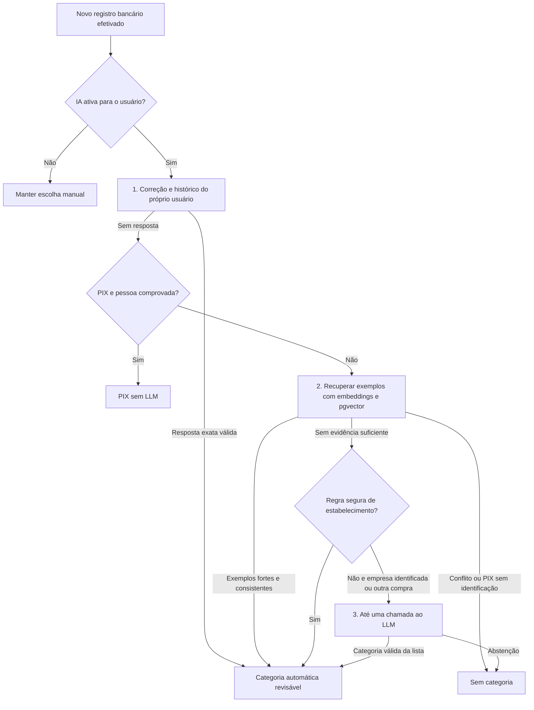

# Organização financeira — versão local, 16/11/2026

Branch `codex/organizacao-financeira-local`. Esta entrega **não foi publicada**, enviada ao GitHub ou integrada por PR. Usa exclusivamente o perfil fictício local. As publicações anteriores continuam no estado registrado em `publicacao-categorias-padrao-2026-11-16.md`; não houve nova consulta de produção para este trabalho.

## O que foi pedido e decidido

- Separar transferências próprias, faturas e investimentos dos indicadores de consumo/economia, com confirmação manual, preservando o extrato e o fluxo de caixa.
- Categorias automáticas corrigíveis; criar padrões ao vincular banco e iniciar a primeira leitura. Controle em Configurações, sem o aviso superior em Movimentações. Uma desativação anterior é respeitada.
- PIX de pessoa identificada → PIX; empresa → contexto/histórico/RAG e, somente quando necessário, LLM. Documento ausente não permite adivinhar pelo nome.
- Três etapas, **até uma chamada ao LLM por análise**, não três tentativas pagas. Usuário confirmou essa opção.
- Primeiras versões funcionais de Investimentos e chatbot de metas. Usuário confirmou ambas. Sem criação de lançamentos/postings ou alterações nos saldos.

## Categoria não é natureza financeira

Categoria responde “como organizar este gasto?”. Natureza responde “isto é consumo/renda ou movimentação patrimonial?”.

Uma compra em mercado pode receber categoria automaticamente. Já `Aplicação RDB` recebe identificação de investimento para você conferir; somente **Confirmar natureza financeira** exclui esse registro dos indicadores comuns. Ele continua visível no extrato. Fatura e transferência própria também exigem confirmação: uma descrição isolada não comprova a finalidade nem garante ausência de compras faltantes.

`consumption_record` deriva de `financial_record` e retira apenas naturezas confirmadas válidas. Dashboard, categorias de despesas e orçamentos usam essa projeção; o fluxo de caixa mantém os registros originais. Links dos indicadores aplicam o mesmo filtro na lista, evitando total e detalhamento divergentes. A lista “sem categoria” não cobra classificação de uma natureza patrimonial já confirmada.

Confirmações têm proprietário, versão e assinatura de descrição/valor/data/direção/status. Mudança desses dados invalida a confirmação e exige nova análise. Cancelamento, lançamento associado ou vínculo de transferência também a invalidam. Ocultar retira dos indicadores; restaurar reaplica uma confirmação ainda válida. Para corrigir uma identificação, confirme “Renda ou consumo comum”. Para pares de transferência existentes, desfaça o par antes de mudar a natureza.

## Categorização na prática

As regras baratas fazem parte das decisões antes do modelo; não são chamadas extras. Correções humanas e categorias retiradas manualmente não são sobrescritas. Decisões originais do LLM podem ser reutilizadas para descrição idêntica, com origem MEMORY, sem virar exemplo humano.

O Pluggy fornece `paymentData.receiver.documentNumber.type` em saídas e `payer` em entradas. Persistimos **PERSON/BUSINESS/UNKNOWN**, nunca o valor do CPF/CNPJ. `merchant.businessName` pode identificar empresa quando o documento não vem. Não enviamos documentos, valores ou saldos ao categorizador. A requisição de categoria envia descrição minimizada, tipo da contraparte, categorias permitidas e exemplos limitados ao proprietário.

RAG mantém MiniLM/384 dimensões e pgvector já existentes. Até cinco exemplos recuperados vão à decisão. Nesta versão, dois exemplos consistentes com similaridade ≥0,88 permitem RAG sem LLM; esse limiar é experimental, não probabilidade calibrada. Casos conflitantes se abstêm. A implementação é `pipeline.py`, `vector_app.py` e `vector-lab/finance_vector/ui_service.py`; Java faz a autorização e a aplicação versionada.

Uma análise concluída sem categoria recebe `NO_CATEGORY` e não volta à fila repetidamente por atualização da tela/banco. Mudança dos dados pelo banco, permissão explícita de nova classificação ou nova correção humana para a mesma descrição podem permitir reanálise. Uma falha cloud transitória não é tratada como decisão de categoria: a fila existente mantém recuperação. “Retomar processamento interrompido” retoma trabalho pendente, sem apagar as abstenções. Novo catálogo ou regras futuras precisam de uma invalidação deliberada; não reprocessar todo o histórico silenciosamente.

### Exemplos fictícios

| Registro | Caminho esperado | LLM |
|---|---|---|
| PIX enviado para pessoa fictícia, tipo PERSON | Regra → PIX | Zero |
| PIX de empresa com correção exata anterior | Histórico/correção → categoria do usuário | Zero |
| Descrição com dois exemplos vetoriais fortes e concordantes | RAG → categoria dos exemplos | Zero |
| PIX de empresa sem regra/evidência | Uma chamada; pode responder categoria permitida ou abster-se | No máximo uma |
| PIX sem contraparte identificada e sem contexto confiável | Sem categoria | Zero |
| Aplicação automática RDB | Identificação de natureza, aguardando confirmação | Zero |

O modelo de teste simulado conta as chamadas e valida também a abstenção. Na execução local padrão o Groq está **desligado**; não confundir teste do caminho do LLM com nova chamada real à API. O serviço mantém limites/cache de custo já existentes e `max_retries=0` no cliente Groq.

## Contexto financeiro público no banco

V14 cria `financial_knowledge`, com padrão de palavras, direção, natureza, instrumento, explicação, fonte, revisão e ativação. Cinco regras iniciais: aplicações/resgates RDB/CDB e pagamento de fatura. Não mistura descrições financeiras privadas de usuários. Uma consulta carrega as regras e as aplica em memória, sem uma consulta por registro.

“Aplicação RDB” sugere renda fixa em qualquer instituição. No Nubank pode ser Caixinha, mas não presumimos que toda Caixinha seja RDB, liquidez, taxa ou rentabilidade. Fonte: [documentação do Nubank sobre Caixinhas](https://nubank.com.br/nu/imposto-de-renda/como-declarar-caixinhas-nubank). A natureza exige confirmação. Esta base usa regras determinísticas; **não foi vetorizada**. O pgvector continua reservado aos exemplos privados de categorização, isolados por usuário.

## Investimentos: primeira versão

- Tela **Investimentos** lista identificações pendentes, aplicações/resgates confirmados e posições informadas.
- Cadastro/atualização de posição contém nome, instituição, tipo, valor atual informado e data. Não compra, resgata nem calcula rendimento.
- Aportes, resgates e aportes líquidos identificados são totais de fluxos, **não saldo investido**. Resgate pode incluir juros; não separarmos principal/rendimento sem dados.
- Uma natureza confirmada pode apontar para uma posição do mesmo usuário e produto. Valores de posição permanecem informativos, sem somar automaticamente ao saldo das contas.
- Mostra até 100 sugestões/registros recentes; totais confirmados consideram todos. Sugestões examinam os 100 registros elegíveis mais recentes. Sem paginação/valoração automática nesta primeira versão.

## Chatbot: primeira versão

Fluxo real: tela → Java `/api/goals/chat` (sessão/CSRF) → Python autenticado `/planning/interpret` → cadeia LangChain `ler_objetivo | interpretar_sem_llm` → estrutura validada → Java calcula o plano e consulta o resumo do próprio usuário.

Exemplo: “Quero viajar e guardar 3000” → `target=3000,title=Viagem`; “em 6 meses” → `months=6`; “já tenho 600 reservado” → `saved=600`; Java calcula `(3000−600)/6 = 400.00`. Salvar exige **Confirmar e salvar meta**. O valor já reservado é progresso declarado, não uma transferência. Arredondamento para cima evita faltar centavos.

Também reconhece pedidos simples de resumo e “posso comprar/gastar X?”. Compara com a sobra **registrada** no mês, sem afirmar disponibilidade real ou descontar obrigações desconhecidas. Não consulta o banco para executar pagamentos. O Python recebe apenas o texto e o estado da meta; não recebe saldos, extratos ou valores dos relatórios. Nenhuma chamada ao Groq nesse planejador. Limite por processo: 20 mensagens/minuto/usuário; não substitui limite distribuído para futura escala.

Limites desta primeira versão: interpretação por regras em português, não conversa geral; contexto temporário de até 20 mensagens na tela; somente metas confirmadas persistem; meses são horizonte de planejamento informado e não contagem automática até uma data; nenhuma recomendação de ativos, juros ou execução bancária. A reserva e os limites cadastrados ainda não compõem um simulador completo de compromissos futuros.

## Rodar e conferir

1. Em ambiente local já preparado, executar `pwsh -NoProfile -File scripts/start-review-vector-ai.ps1 -Build -AutomaticCategories`.
2. Abrir `http://127.0.0.1:8082`. Usar o perfil fictício documentado em `demo-revisao-local.md`; nunca copiar credenciais de produção.
3. **Configurações** contém o controle. **Movimentações** mostra os exemplos, a categoria automática, os casos sem categoria e os detalhes para corrigir/confirmar natureza.
4. Abrir uma aplicação RDB: conferir identificação, selecionar produto/posição opcional e marcar confirmação. Comparar consumo, extrato e saldo.
5. Abrir **Investimentos** e **Metas e planejamento**; testar os exemplos acima.

O launcher verifica banco/perfil/containers fictícios, limpa variáveis financeiras herdadas e usa Java8082, Python8126, app PostgreSQL55434 e pgvector55435. A semente de organização exige o schema local atualizado, preserva categorias existentes, postings e saldos bancários e compensa os fluxos fictícios adicionados. Não roda provisionamento de nuvem. `-UseGroq` é opção separada; não foi usada nesta validação.

## Migrações, publicação futura e rollback

V14 é aditiva: metadados, conhecimento público, posições, naturezas e metas; nenhuma classificação, preferência, posting ou saldo existente é alterado. V15 acrescenta a invalidação da natureza após pareamento/cancelamento. V14 foi mantida imutável depois da primeira aplicação ao banco fictício; nenhum `repair` de checksum foi feito.

Antes de publicar: autorização explícita, revalidar recuperação do banco correto e aplicar V14/V15 em branch Neon isolada com testes. Não iniciar Java com conexão real para “apenas testar”, pois Flyway migra no startup. Não executar Prisma nem `cloud-provision.mjs`. Publicar o Python compatível antes do Java que chama a nova rota. Revalidar comunicação protegida, limites, latência e contrato dos dados reais Pluggy sem importar lançamentos.

Rollback de código: voltar aos artefatos anteriores, preservando a chave Groq rotacionada atual. A estrutura aditiva pode permanecer; código antigo continua usando `financial_record`. Isso faz os indicadores voltarem à regra antiga, incluindo registros patrimoniais, portanto não confundir com mudança de saldo. Não apagar tabelas/dados ou fazer downgrade de Flyway automaticamente. Para reverter uma natureza, usar confirmação ORDINARY; para interromper categorias, desligar a preferência individual. Posições/metas são informativas e não exigem estorno bancário.

## Validação

Resultados locais finais:

| Verificação | Resultado |
|---|---|
| Java unitários | 41 aprovados |
| Java integração, PostgreSQL descartável | 83 aprovados; os 35 afetados pela última revisão foram repetidos e passaram |
| Python categorização/planejador | 45 aprovados na venv vetorial + um teste legado Ollama na venv apropriada; nenhum teste cloud real executado |
| Embeddings/pgvector reais locais | 10 aprovados |
| Frontend | lint, três testes e build aprovados; aviso existente de bundle grande (~1,09MB sem gzip) |
| Tela integrada Java/Python/PostgreSQL | um cenário completo aprovado, depois repetido com dados já existentes e aprovado |
| Segredos | Gitleaks sem achados; 12 valores protegidos comparados em memória com fontes/recursos públicos sem correspondências; nenhum arquivo privado versionado |

No cenário de tela, confirmar a aplicação fictícia retirou R$300 do consumo, mas manteve saldo e fluxo de caixa. A posição informativa de R$800 não alterou contas. A conversa gerou meta3000/reserva600/prazo6 e R$400/mês, salva somente após clique. PIX PERSON recebeu PIX, UNKNOWN ficou sem categoria. Zero requisições externas do navegador e zero erros JavaScript. O caminho de uma chamada LLM foi verificado com modelo simulado; o Groq real ficou desligado.

Os testes antigos precisaram considerar a primeira leitura agora feita no vínculo: nova entrega simulada só ocorre depois de liberar explicitamente o limitador de um minuto no fixture. As asserções de saldo, rollback transacional e idempotência foram preservadas; o timestamp anterior passou a ser comparado com o da primeira leitura, em vez de assumir ausência de leitura. Relatórios XML consolidados: 124 testes Java, zero falhas/erros. Não houve reparo de checksum.

Evidências detalhadas, capturas e logs ficam em `.tools`/saídas ignoradas, nunca no Git. Testes são locais; não demonstram funcionamento do deployment de produção.
